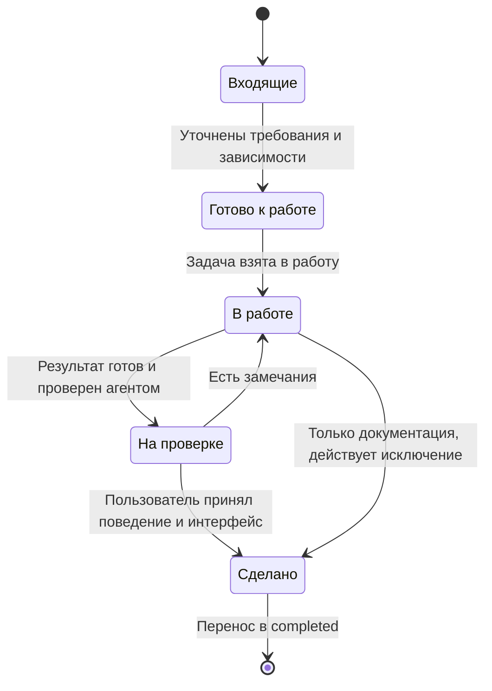

# Очередь работ

Задачи ведутся в Backlog.md: карточки — Markdown-файлы, доска и CLI работают с теми же файлами. Очередь и история работ не дублируются планами в `docs/`.

## Статусы

| Статус | Значение |
|---|---|
| Входящие | Идея или запрос ещё не разобраны |
| Готово к работе | Понятны результат, границы, критерии приёмки и зависимости |
| В работе | Задача взята в работу |
| На проверке | Реализация и проверки завершены, ожидается подтверждение пользователя |
| Сделано | Результат принят пользователем; для чисто документационной задачи действует исключение из [AGENTS.md](../AGENTS.md#git) |



До подтверждения пользователя задача с изменениями приложения остаётся «На проверке». Пользователь проверяет поведение и интерфейс; ответственность за код и технические проверки определена в [AGENTS.md](../AGENTS.md#ответственность-и-совместные-решения). После подтверждения переведи её в «Сделано», затем выполни `backlog task complete`: карточка переместится в `completed/` и исчезнет с активной доски. Карточка фиксируется тем же коммитом, что и работа.

## Хранение

- `config.yml` — имя проекта, статусы, метки и настройки инструмента.
- `tasks/` — активные карточки.
- `drafts/` — черновики, ещё не включённые в очередь.
- `completed/` — завершённые карточки с результатами и доводами того времени; открываются по конкретному историческому вопросу.
- `archive/tasks/` — отменённые или потерявшие актуальность карточки с причиной отказа.
- [templates/task.md](templates/task.md) — подсказка по содержанию карточки; это не активная задача.

Карточки создавай и меняй через CLI или доску, чтобы инструмент сохранял идентификаторы, метаданные и служебную разметку. Не копируй шаблон в `tasks/` как готовый файл. Метки обозначают область работы; зависимости указываются идентификаторами карточек. Новые задачи добавляй сразу, отменённые архивируй, не удаляя историю.

## Содержание карточки

Описание содержит проблему, ожидаемый результат, границы и ссылки на документацию. Критерии приёмки должны быть проверяемыми. План хранится в карточке и перечисляет файлы, порядок шагов, риски и проверки. Итог содержит результат, проведённые проверки и оставшиеся ограничения.

Предварительная спецификация может жить в карточке; перед кодированием согласованные требования переносятся в `docs/`, а в карточке остаётся ссылка. Постоянное знание не должно оставаться только в истории задач.

## Команды

Нужен установленный CLI Backlog.md (`backlog`). Выполняй команды из корня проекта; идентификатор `TASK-001` ниже — пример.

```powershell
backlog task list --plain
backlog browser
backlog task create "Краткое название" --description "Проблема и ожидаемый результат" --ac "Проверяемый критерий"
backlog task view TASK-001 --plain
backlog task edit TASK-001 --status "Готово к работе"
backlog task edit TASK-001 --status "В работе"
backlog task edit TASK-001 --plan "Порядок реализации и проверки"
backlog task edit TASK-001 --status "На проверке"
# После приёмки:
backlog task edit TASK-001 --status "Сделано"
backlog task complete TASK-001
# Отмена задачи вместо завершения:
backlog task archive TASK-001
```

Настройки находятся в [config.yml](config.yml): порт этой доски — `6423`, автоматическое открытие браузера, коммиты и обращения к удалённым веткам отключены. Если порт занят, укажи другой через `backlog browser --port <номер>`.

Локальный Git и remote настроены, включена интеграция с репозиторием (`filesystem_only: false`); автоматические коммиты остаются выключенными (`auto_commit: false`). Временные блокировки и данные запущенной доски не относятся к каркасу и не переносятся между проектами.
