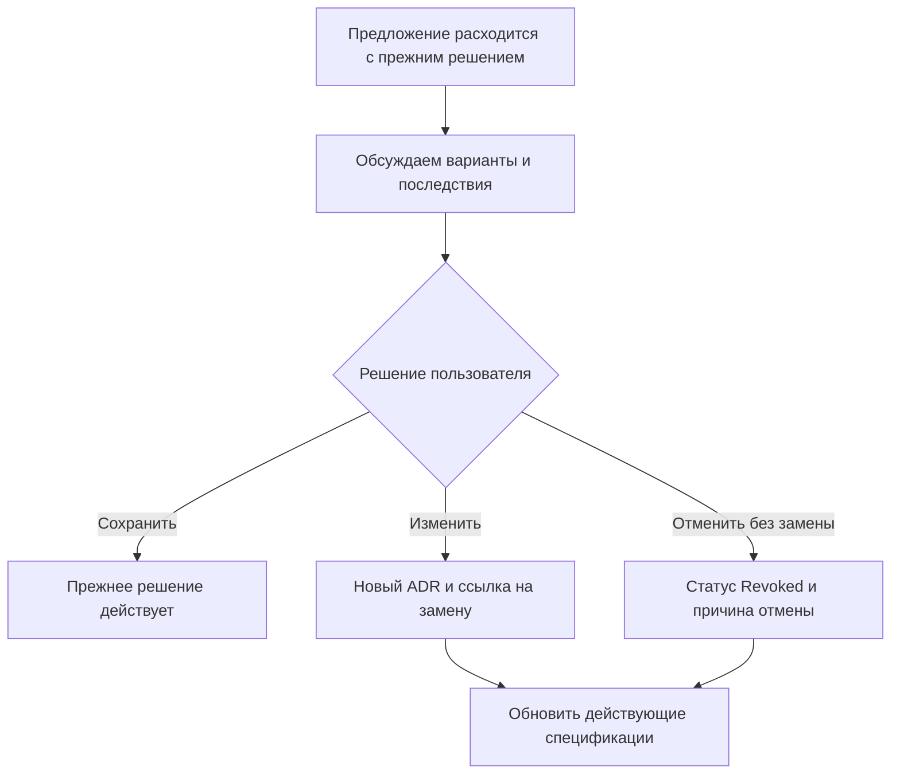

# Architecture Decision Records

Значимые архитектурные решения: один файл на решение, контекст → решение → последствия. Для нового документа используй [template.md](template.md).

Имя — `NNNN-short-decision-name.md`, номер сквозной, начиная с `0001`; освободившиеся номера повторно не используются.

Статусы: `Proposed`, `Accepted`, `Rejected`, `Deferred`, `Superseded by ADR NNNN`, `Revoked` (отменено без замены). Предложение можно уточнять до принятия. Статус `Rejected` относится к непринятому предложению, `Revoked` — к отменённому ранее принятому решению.

При добавлении ADR обнови реестр ниже и [карту документации](../../README.md).

## Пересмотр решений

ADR сохраняет контекст и причины выбора. Правило обсуждения противоречий и приоритет нового решения пользователя определены в [AGENTS.md](../../../AGENTS.md#пересмотр-соглашений).

- **Замена или существенное изменение:** создай новый ADR с актуальным решением и ссылкой на прежний. У прежнего поставь `Superseded by ADR NNNN` со ссылкой на замену.
- **Отмена без замены:** поставь `Revoked` и добавь краткую запись с датой, причиной и последствиями отмены. Новый ADR только ради отмены не требуется.
- **Уточнение без смены смысла:** добавь явно отмеченное пояснение к существующему ADR. Если меняется смысл или область действия, оформи замену.
- Исходный контекст, решение и последствия сохраняй: не удаляй документ и не переписывай историю так, будто прежнего выбора не было. Обнови реестр и затронутые спецификации, чтобы было понятно, какое решение действует сейчас.

## Решения

Технические решения пока не приняты. Реестр заполняется по мере обсуждения требований и выбора архитектуры One Beep.
